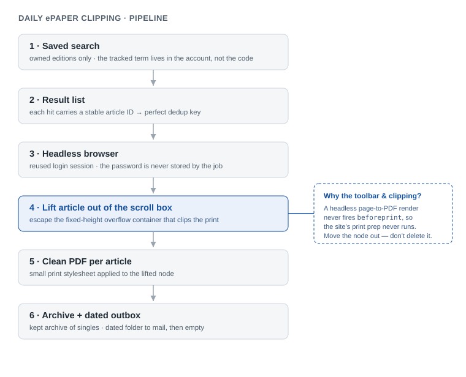

# Automating a Daily ePaper Press-Clipping — and the Headless-Print Gotcha Behind It

- **Type:** Automation / web reverse-engineering (authenticated single-page app)
- **Environment:** A regional newspaper's subscriber ePaper portal — an Angular single-page app behind a login
- **Surface:** Headless browser automation, session cookies, DOM and print CSS, scheduled jobs
- **Category:** Browser automation, authenticated web content, secure credential handling
- **Date:** 2026-11

## Environment & Scope

An organization tracked every mention of itself in a regional newspaper's digital edition. Each day someone logged into the paper's ePaper portal, searched a fixed term, opened each matching article, saved it as a PDF, and sent the set around. Tedious, and only a handful of articles — if any — on a given day.

The task was to turn the repetitive part into one unattended run: detect the day's matching articles, save each as its own PDF, never re-pull old ones, and optionally hand the set off for mailing.

All identifiers in this writeup are anonymized. The organization, the newspaper, the account, and the tracked search term are removed or generalized. The portal is described only at the level needed to make the technique reusable: a subscription ePaper reader built as an Angular app. No credentials and no third-party system are exposed, and the content itself is never reproduced.

## Objective

Reproduce a human's daily clipping routine headlessly and reliably: log in once, every day pull only that day's matching articles, render each as a clean readable PDF, deduplicate across runs, and keep the archive and the outgoing copy separate — without ever storing the account password in the automation.

## Investigate before building: what the portal already offered

Two findings changed the design before a line of automation was written, and both came from looking rather than assuming.

**The portal already had a saved-search feature.** You register a search term once and the portal pre-filters each new edition for it, flagging new hits with a count badge. That removed the daily *search* entirely and became the detection layer — a setting that lives in the account, not something the automation re-implements. A useful consequence for anonymity: the tracked term never has to live in the code at all; the job simply harvests whatever that saved search returns.

**Hits spanned editions the account did not own.** The saved search queried every regional edition, and most required a separate purchase. The relevant local coverage sat in the one owned edition, so constraining the view to *purchased editions* — a single URL parameter — returned exactly the openable articles, with no paywall in the way. Reading the portal's own filter options replaced a lot of guesswork.

A third finding set the whole download architecture, and it is the interesting one.

## The core problem: a clean print that wasn't

The reader is an Angular single-page app. Its "Print" control simply calls the browser's print path and hands off to the native "Save as PDF" dialog. A browser automation tool cannot click that OS-level dialog — it lives outside the page — so any plan built on "click Print, then click Save" is a dead end. The clean equivalent under automation is a headless browser's own page-to-PDF call, which renders the page's print stylesheet straight to a file with no dialog.

The first headless PDFs came out wrong: the reader's toolbar was baked into the top of the page, and the article text was clipped after the first screen. Manually clicking Print in a real browser produced a clean, complete, multi-page article; the headless render did not. Same page, same print media — different result.

### Step 1: separate the two symptoms

Two things were wrong at once: the toolbar appeared (so the print stylesheet was not hiding chrome the way a real print did), and the body was truncated (so something was clipping the content height). Treating them as one bug would have been a mistake; they had different causes.

### Step 2: find what clips the body

Walking the article's ancestor chain in the live DOM, every element around the text had visible overflow and full height — except one. A single wrapper a few levels up was a fixed-height (~640px) scroll box with `overflow: auto`. On screen you scroll inside it; in print, the page is constrained to that box and the rest of the article is simply cut. The content was never the problem; one ancestor container was.

### Step 3: find why the print stylesheet did not apply

This is the non-obvious part. Clicking Print in a real browser fires a `beforeprint` event, and this reader — like many SPA readers — uses a `beforeprint` handler to restructure itself for printing: hide the toolbar, expand the article. A headless page-to-PDF call renders with print media but **does not dispatch `beforeprint`**. So the site's own print-prep never ran, and the headless render captured the raw on-screen view: toolbar included, article clipped to the scroll box. The error — a bad PDF — and the mechanism were one layer apart, and only inspecting the live DOM made the gap visible.

### Step 4: stop depending on the site's print path

Rather than trying to re-trigger the site's print behaviour (fragile, and it fights the SPA's own layout), the fix sidesteps it: lift the article's content node out of the scroll container and make it the sole child of a cleaned page body, then render. Out of the fixed-height box and away from the app's flex ancestors, the full article lays out at its natural height; the toolbar, left behind, is gone. Because this happens in the same page, images that already loaded stay valid — no re-fetching, no cross-origin trouble.

One dead end is worth recording. An earlier attempt *removed* the unwanted nodes instead of moving the wanted one out. Deleting nodes that the Angular app still references sent its change-detection into an error loop and froze the renderer. Moving the content you want — and leaving the framework's nodes untouched — is both simpler and stable. With the raw export working, a small print stylesheet on the lifted node turned it into a clean, typeset clipping.

## Authentication without storing a password

The content is behind a login, so the automation needs a session — but it never needs the password. The approach: one interactive login by hand (2FA included) saves the post-login session state to a local file; every subsequent headless run reuses that state. The password is typed once, by a person, into a real browser, and is never seen by the automation or written to disk by it.

The saved session is then treated as what it is — a credential. It is kept out of version control, and when it eventually expires the job fails loudly with a re-login prompt rather than silently producing nothing. This is the same discipline as any token-handling: do not embed the secret, scope it, and make its expiry visible.

## Deduplication and the two-bucket output

Each result in the list carries a stable, unique article identifier in its link, which doubles as a perfect dedup key: downloaded IDs are recorded in a small local file, so re-runs and overlapping date windows never produce duplicates. A deliberate override re-pulls a day on demand for verification, without disturbing the normal "new only" behaviour the daily run relies on.

Output is split into two buckets on purpose: a kept archive of individual article PDFs, and a dated throwaway "outbox" folder for the day's set — download to both, mail the outbox, then empty it. The daily run stays dumb and idempotent; a human decides when something gets sent.

## Honest trade-offs

- **Driving a live site's DOM is inherently brittle.** A portal redesign can break the selectors. They are isolated in one place so a fix is a one-line change, but the maintenance cost is real and named up front, not hidden. This is a property of browser automation, not a bug in this one.
- **Schedule it on the machine that holds the session,** not a cloud runner. A datacenter IP plus a fresh session is exactly what login walls are built to stop.
- **The lightweight path covers most of the value.** A one-click launcher — or even a bookmarklet that just opens the day's pre-filtered page — removes the daily *search* with zero maintenance. The full unattended pipeline only earns its complexity once hands-off download *and* hand-off for mailing are both required.

## Remediation and hardening

- **Treat the session file as a secret.** Keep it out of version control, restrict its file permissions, and re-create it on demand rather than letting a long-lived copy linger. It grants account access until it expires.
- **Least information.** The job requests only the owned, openable editions and writes only the matching articles — never whole editions, never content it has no right to.
- **No secrets in the repository.** Real values (portal URL, recipients, any mail credentials) live in an ignored local config; the committed example holds only placeholders. The tracked search term stays in the account, not the code.
- **Fail visibly.** An expired session or a moved selector should stop with a clear message, never silently ship an empty or malformed result.
- **Scope any mail step.** If the hand-off is automated later, use a dedicated low-value sender account and an app password, not a real mailbox's primary credentials.

## Key takeaway

The headline lesson is the `beforeprint` gap: a headless page-to-PDF render is *not* the same as a user pressing Print, because the events a site relies on to prepare its print layout never fire. When a headless export looks wrong but the manual one is fine, suspect the print-event path before blaming the content, and inspect the live DOM to find the one container that actually clips. The second lesson is quieter and more durable: investigate the system before automating it — the portal's own saved-search and edition filter did more work than any code would have — and handle the login as a scoped, disposable session so the automation is useful without ever holding the password.
